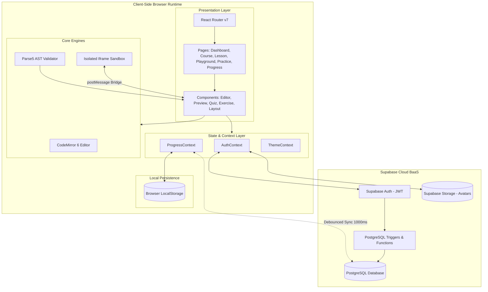
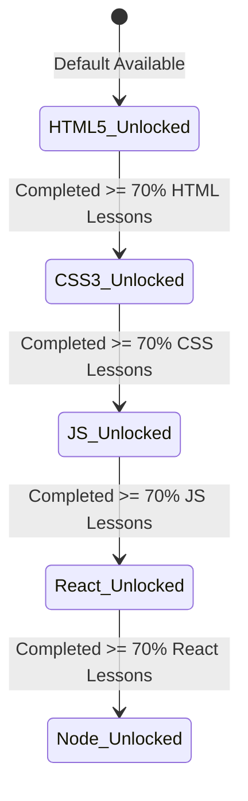
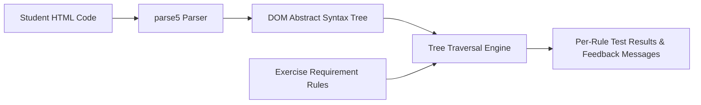
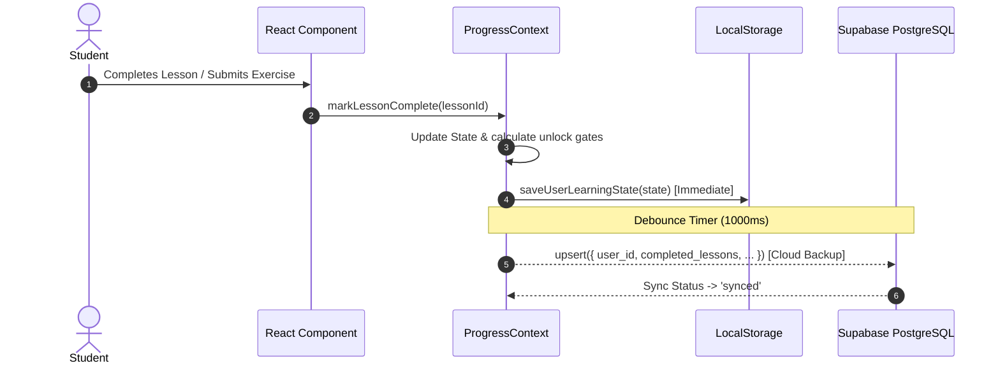
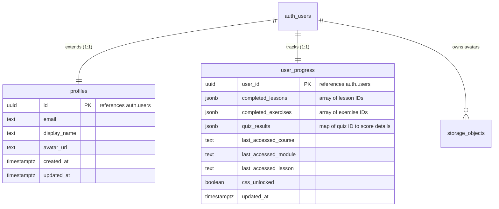
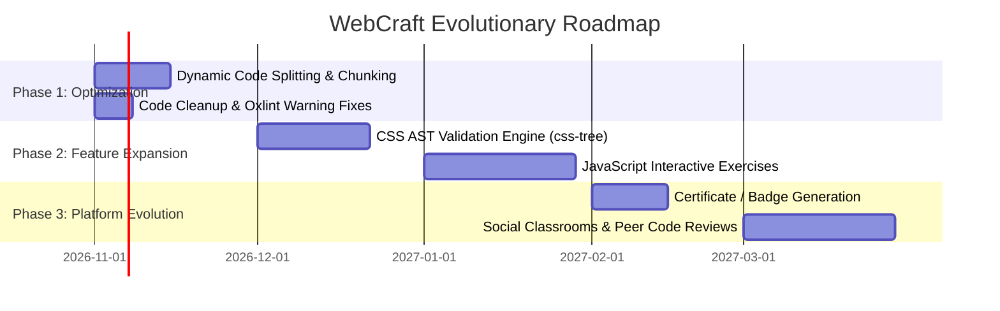

# WebCraft: Comprehensive Technical Architecture & Project Analysis

**Document Version:** 1.0.0  
**Project Name:** WebCraft (`html-css-playground`)  
**Repository Path:** `/home/chakresh/Web-craft`  
**Date of Analysis:** October 2026  
**Audience:** Technical Leadership, Full-Stack Engineers, Product Managers  

---

## Table of Contents

1. [Executive Summary](#1-executive-summary)
2. [High-Level System Architecture](#2-high-level-system-architecture)
3. [Technology Stack & Core Dependencies](#3-technology-stack--core-dependencies)
4. [Directory & Module Structure](#4-directory--module-structure)
5. [Core Subsystems & Feature Breakdown](#5-core-subsystems--feature-breakdown)
   - [5.1 Sequential Curriculum & Progression Engine](#51-sequential-curriculum--progression-engine)
   - [5.2 Interactive Sandboxed Playground](#52-interactive-sandboxed-playground)
   - [5.3 AST-Based Exercise Validation Engine](#53-ast-based-exercise-validation-engine)
   - [5.4 Interactive Assessment & Quiz System](#54-interactive-assessment--quiz-system)
   - [5.5 Dual-Tier State Management & Data Sync](#55-dual-tier-state-management--data-sync)
   - [5.6 Authentication & Profile Management](#56-authentication--profile-management)
   - [5.7 Design System, Theming & Responsiveness](#57-design-system-theming--responsiveness)
6. [Curriculum Content & Educational Scope](#6-curriculum-content--educational-scope)
7. [Database Schema & Security Architecture](#7-database-schema--security-architecture)
8. [Code Quality, Linting & Build Performance](#8-code-quality-linting--build-performance)
9. [Identified Technical Debt, Gaps & Risks](#9-identified-technical-debt-gaps--risks)
10. [Strategic Roadmap & Recommendations](#10-strategic-roadmap--recommendations)

---

## 1. Executive Summary

**WebCraft** is a modern, interactive web application engineered to teach web development through structured, hands-on learning. Built with **React 19**, **Vite 8**, **Tailwind CSS**, and **Supabase**, WebCraft provides an integrated, self-paced learning environment designed specifically for students to enhance their core frontend markup and styling skills:

- **Active Core Curriculum (Phase 1 Focus):** **HTML5 Fundamentals** (32 lessons, 8 modules) ➔ **CSS3 & Modern Layout** (30 lessons, 8 modules, unlocked at 70% HTML completion).
- **Upcoming Expansion Tracks (Phase 2):** **JavaScript (ES6+) Mastery**, **React.js Components**, and **Node.js Backend Architecture** are staged as "Coming Soon" and temporarily disabled to maintain focus on HTML/CSS skill building.
- In-browser code editing powered by **CodeMirror 6** for both HTML and CSS.
- Isolated live rendering inside a sandboxed iframe with base resets and runtime error forwarding.
- Deterministic automated code grading using the **parse5** HTML AST parser.
- Dual-tier data persistence that guarantees 100% offline functionality via `localStorage` while automatically synchronizing progress with **Supabase PostgreSQL** upon authentication.

The codebase comprises over 17,000 lines of structured educational content, exercises, quizzes, and UI components designed with clean component encapsulation and modern accessibility patterns.

---

## 2. High-Level System Architecture

WebCraft follows a modular single-page application (SPA) architecture with decoupled layers for UI presentation, client state management, sandboxed execution, AST evaluation, and backend-as-a-service (BaaS) persistence.



### Architectural Highlights

1. **Offline-First Resilience:** Users can complete lessons, practice exercises, and use the sandbox without an account or internet connectivity. `localStorage` is the authoritative local store.
2. **Seamless Cloud Elevation:** When a user logs in, progress is merged via union operations between the remote PostgreSQL record and local storage, preventing data loss.
3. **Execution Isolation:** Student code is strictly segregated inside an iframe equipped with `sandbox="allow-scripts"` and `srcdoc` updates, shielded by base normalization resets and window error interceptors.
4. **Deterministic Evaluation:** Student exercise submissions are parsed into an Abstract Syntax Tree (AST) rather than regex string matching, providing robust validation across formatting differences.

---

## 3. Technology Stack & Core Dependencies

### Core Runtime & Build Tooling

| Technology | Version | Purpose | Rationale |
|:---|:---|:---|:---|
| **React** | `^19.2.8` | Core UI Library | Latest concurrent rendering, transitions, and component primitives |
| **React DOM** | `^19.2.8` | DOM Renderer | React 19 web rendering engine |
| **Vite** | `^8.3.0` | Build Tool & Dev Server | Ultra-fast HMR and optimized Rolldown/Rollup production builds |
| **React Router DOM** | `^7.18.4` | Client-Side Routing | Declarative nested routing, dynamic URL parameters, and redirects |
| **Tailwind CSS** | `^3.4.19` | Utility-First Styling | Responsive design, dark mode class strategy, and custom palettes |
| **PostCSS / Autoprefixer** | `^8.5.30` / `^10.6.1` | CSS Tooling | Vendor prefixing and modern CSS transformations |
| **Oxlint** | `^1.81.0` | Rust-based Linter | Extremely fast linting replacing standard ESLint overhead |

### Specialized Libraries

| Package | Version | Purpose in Application |
|:---|:---|:---|
| `@uiw/react-codemirror` | `^4.25.12` | React wrapper for CodeMirror 6 |
| `@codemirror/lang-html` | `^6.4.12` | Syntax highlighting and auto-closing tags for HTML |
| `@codemirror/lang-css` | `^6.3.1` | Syntax highlighting and formatting rules for CSS |
| `parse5` | `^8.0.1` | WHATWG-compliant HTML parser for AST generation and validation |
| `@supabase/supabase-js` | `^2.117.3` | Client SDK for Auth, Database queries, and Storage buckets |
| `lucide-react` | `^1.56.0` | Cohesive, accessible SVG icon library |

---

## 4. Directory & Module Structure

```
Web-craft/
├── .env.example                 # Template for Supabase URL and Anon Key
├── .gitignore                   # Ignores node_modules, dist, .env, OS artifacts
├── .oxlintrc.json               # Oxlint configuration schema and rules
├── index.html                   # HTML entry point with viewport & font metadata
├── package.json                 # Manifest of dependencies and scripts
├── postcss.config.js            # PostCSS configuration
├── tailwind.config.js           # Tailwind theme extensions & dark mode config
├── vite.config.js               # Vite server settings and plugins
├── docs/                        # Project architectural documentation
│   └── PROJECT_ANALYSIS.md      # This comprehensive technical analysis document
├── supabase/                    # Backend database and storage definitions
│   └── schema.sql               # PostgreSQL tables, triggers, RLS policies & buckets
└── src/                         # Application source code
    ├── main.jsx                 # Application bootstrapping and React 19 root
    ├── App.jsx                  # Top-level context providers wrapper
    ├── index.css                # Base Tailwind imports and global style resets
    ├── app/
    │   └── router.jsx           # Central route definitions and navigation guards
    ├── components/              # Modular UI components
    │   ├── auth/                # Modal dialog for login, signup, and OAuth
    │   │   └── AuthModal.jsx
    │   ├── dashboard/           # Dashboard course cards, activity feeds, resume banner
    │   │   ├── ContinueLearning.jsx
    │   │   ├── CourseCard.jsx
    │   │   └── RecentActivity.jsx
    │   ├── exercises/           # Interactive coding exercise interface & result panel
    │   │   └── ExerciseEditor.jsx
    │   ├── layout/              # Universal header, course navigation sidebar, page frame
    │   │   ├── AppHeader.jsx
    │   │   ├── CourseSidebar.jsx
    │   │   └── PageLayout.jsx
    │   ├── lesson/              # Lesson viewer, markdown prose, snippets, TOC
    │   │   ├── CodeSnippetBox.jsx
    │   │   ├── IncompleteLessonModal.jsx
    │   │   ├── LessonContent.jsx
    │   │   ├── LessonNavigation.jsx
    │   │   ├── PracticeTaskBox.jsx
    │   │   └── TableOfContents.jsx
    │   ├── playground/          # Dual-pane live code workbench
    │   │   ├── CodeEditorPanel.jsx
    │   │   ├── HtmlPreview.jsx
    │   │   ├── PlaygroundLayout.jsx
    │   │   └── PlaygroundToolbar.jsx
    │   └── quizzes/             # Knowledge check quiz runner & scoring card
    │       └── QuizRunner.jsx
    ├── content/                 # Curriculum data banks (17,000+ lines)
    │   ├── css/                 # CSS3 modules and lesson definitions
    │   ├── exercises/           # Practice exercise challenges and test cases
    │   ├── html/                # HTML5 modules and lesson definitions
    │   ├── javascript/          # ES6+ JavaScript modules and lesson definitions
    │   ├── nodejs/              # Node.js backend modules and lesson definitions
    │   ├── quizzes/             # Multi-question assessment quiz datasets
    │   └── react/               # React.js components and hook modules
    ├── context/                 # React Context state providers
    │   ├── AuthContext.jsx      # Supabase authentication session & user profile
    │   ├── ProgressContext.jsx  # Course completion, unlock logic & cloud sync
    │   └── ThemeContext.jsx     # Dark/Light theme switching & persistence
    ├── hooks/                   # Custom reusable React hooks
    │   ├── useAuth.js           # Convenient accessor for AuthContext
    │   └── useProgress.js       # Convenient accessor for ProgressContext
    ├── lib/                     # Core business logic and shared utilities
    │   ├── constants.js         # Initial editor templates and unlock thresholds
    │   ├── courses.js           # Unified registry of courses and metadata
    │   ├── html-validation.js   # Parse5 AST validation algorithm
    │   ├── preview.js           # Iframe document compiler & reset injector
    │   ├── progress.js          # Unlock calculations and course statistics
    │   ├── storage.js           # LocalStorage serialization and hydration
    │   └── supabase.js          # Supabase client instantiation & env checks
    └── pages/                   # Route-level page views
        ├── CoursePage.jsx       # Course overview, module list, syllabus
        ├── DashboardPage.jsx    # Home dashboard, tracks overview, recent activity
        ├── LessonPage.jsx       # Individual lesson reader with editor & tasks
        ├── NotFoundPage.jsx     # 404 handler with return navigation
        ├── PlaygroundPage.jsx   # Dedicated full-screen sandbox workbench
        ├── PracticePage.jsx     # Tabbed view for exercises and quizzes
        └── ProgressPage.jsx     # Comprehensive completion progress & credentials
```

---

## 5. Core Subsystems & Feature Breakdown

### 5.1 Sequential Curriculum & Progression Engine

WebCraft enforces an incremental learning pathway. To prevent cognitive overload and encourage deep mastery, courses unlock in a strict sequence:

$$\text{HTML5} \xrightarrow{\ge 70\%} \text{CSS3} \xrightarrow{\ge 70\%} \text{JavaScript (ES6+)} \xrightarrow{\ge 70\%} \text{React.js} \xrightarrow{\ge 70\%} \text{Node.js}$$



- **Calculation Logic (`src/lib/progress.js`):**
  - Evaluates completed lesson IDs against course syllabus definitions.
  - Generates unlock metadata (`isUnlocked`, `currentPercentage`, `completedPrereqCount`, `totalPrereqLessons`).
  - Automatically produces unlock celebration events in the `recentActivities` feed upon crossing the 70% threshold.
- **Visual Gating:**
  - Locked courses display lock badges, translucent overlays, and instructional requirement banners detailing exactly how many lessons remain before access is granted.
  - Direct URL access to locked lessons triggers an informative fallback prompt directing the student back to the prerequisite material.

### 5.2 Interactive Sandboxed Playground

The Playground (`src/pages/PlaygroundPage.jsx` and `src/components/playground/`) is a dual-pane live code development environment designed for real-time experimentation.

1. **CodeMirror 6 Editor (`CodeEditorPanel.jsx`):**
   - Syntax-highlighted editing for HTML and CSS.
   - Line numbers, active line highlight, automatic bracket closing, and tab indentation.
   - Dark mode synchronization: adapts editor themes dynamically based on `ThemeContext`.
2. **Preview Compilation (`src/lib/preview.js`):**
   - Checks if student input is a complete HTML document (`<!DOCTYPE html>` or `<html>`) or a fragment.
   - Injects student CSS into `<style id="student-injected-css">` within the `<head>`.
   - Injects a standard normalization stylesheet (`#base-preview-reset`) ensuring standard typography, padding, and `box-sizing: border-box`.
3. **Execution Sandbox (`src/components/playground/HtmlPreview.jsx`):**
   - Employs `<iframe sandbox="allow-scripts" srcdoc={...} />`.
   - Does **not** include `allow-same-origin`, preventing student code from accessing the parent application's cookies, local storage, or DOM.
   - Includes an inline error interceptor (`window.onerror`) that forwards uncaught errors across iframe boundaries via `window.parent.postMessage({ type: 'PREVIEW_ERROR', ... })` to display non-intrusive runtime error banners.

### 5.3 AST-Based Exercise Validation Engine

Rather than relying on fragile string matching or regular expressions that break on simple whitespace variations, WebCraft employs **parse5** (`src/lib/html-validation.js`) to parse student HTML into an Abstract Syntax Tree.



#### Rule Types Evaluated:
1. **Tag Presence & Cardinality:** Confirms presence of tags (e.g., `h1`, `nav`, `ul`, `img`) and verifies `minCount` and `maxCount`.
2. **Attribute Verification:** Inspects element attributes (e.g., `href` on `<a>`, `src` and `alt` on ``), checking for non-empty values and optional regex patterns.
3. **Content Verification:** Recursively extracts nested text (`getNodeText`) to verify expected substrings or pattern matches within targeted tags.
4. **Hierarchical Relationships:** Validates parent-child relationships (e.g., `<nav>` containing `<ul>`, `<ul>` containing `<li>`).

### 5.4 Interactive Assessment & Quiz System

The Quiz Engine (`src/components/quizzes/QuizRunner.jsx`) provides formative assessments:
- Multiple-choice questions with randomized distractors.
- Immediate visual feedback on selection: green highlights for correct selections, red for incorrect selections.
- Detailed technical explanations explaining *why* an answer is correct.
- Minimum passing threshold (typically 70%–80%) to mark the quiz as passed.
- Results are recorded in `ProgressContext` under `quizResults` and persisted to Supabase and LocalStorage.

### 5.5 Dual-Tier State Management & Data Sync

State management is handled via React Context without the overhead of external state libraries like Redux or Zustand. The synchronization pipeline balances instant UI updates with reliable cloud backup:



#### Synchronization Details:
- **Immediate Local Persistence:** Any state update (`completedLessons`, `completedExercises`, `quizResults`, `editorDrafts`) instantly commits to `localStorage`.
- **Debounced Remote Upsert:** Remote synchronization triggers 1,000 milliseconds after the last state mutation, eliminating unnecessary network round-trips while typing in editors.
- **Login Re-conciliation:** When an authenticated user signs in, WebCraft queries `user_progress` and merges the remote and local arrays via a Set union (`Array.from(new Set([...local, ...remote]))`), ensuring work done offline prior to login is never overwritten.

### 5.6 Authentication & Profile Management

User authentication (`src/context/AuthContext.jsx` and `src/components/auth/AuthModal.jsx`) is powered by Supabase:
- **Methods:** Email/password registration and login, plus Google/GitHub OAuth integrations.
- **Database Trigger Automation:** The PostgreSQL schema includes `handle_new_user()` which automatically creates a matching row in `public.profiles` and initializes an empty row in `public.user_progress` upon auth signup.
- **Avatar Storage:** Includes a dedicated Supabase Storage bucket (`avatars`) with user-isolated folder upload policies based on `auth.uid()`.

### 5.7 Design System, Theming & Responsiveness

- **Color Palette:** Carefully tailored dark and light mode palettes using slate and zinc neutrals with semantic accents:
  - HTML: Orange (`#ea580c`)
  - CSS: Blue (`#2563eb`)
  - JavaScript: Amber/Yellow (`#eab308`)
  - React: Cyan (`#06b6d4`)
  - Node.js: Emerald (`#059669`)
- **Theme Persistence:** `ThemeContext` monitors the system preference (`prefers-color-scheme`) and persists explicit user choices in `localStorage`, toggling the `dark` class on the root document element.
- **Mobile Adaptations:** The Playground features a responsive layout switcher allowing mobile users to toggle seamlessly between the Code Editor and Live Preview tabs.

---

## 6. Curriculum Content & Educational Scope

WebCraft hosts **17,353 lines** of curriculum code and structured lessons across 5 tracks:

| Course Track | Modules | Lessons | Est. Content Lines | Key Topics Covered |
|:---|:---:|:---:|:---:|:---|
| **HTML5 Fundamentals** | 8 | 32 | 6,805 | Tags, document trees, semantics, multimedia (`<video>`, `<audio>`), forms, validation, accessibility (ARIA), tables |
| **CSS3 & Modern Layout** | 8 | 30 | 5,090 | Box model, typography, Flexbox deep dive, CSS Grid, custom properties, transforms, keyframe animations, responsive queries |
| **JavaScript (ES6+)** | 4 | 16 | 1,566 | Data types, closures, arrow functions, promises, async/await, Array methods (`map`/`filter`/`reduce`), DOM manipulation, Event loop |
| **React.js Components** | 4 | 16 | 1,380 | JSX, props, state, `useState`, `useEffect`, `useContext`, custom hooks, form handling, conditional rendering, performance |
| **Node.js Architecture** | 4 | 16 | 1,509 | Node runtime, event loop, CommonJS vs ESM, `fs` and `path`, streams, Express REST APIs, middleware, HTTP status codes |
| **Practice & Quizzes** | - | 12+ | 480 | Real-time AST coding challenges, multi-question comprehension quizzes |
| **Total** | **28** | **110+** | **17,353** | **Complete Full-Stack Curriculum** |

---

## 7. Database Schema & Security Architecture

The database architecture is defined in `supabase/schema.sql`.

### Relational Schema Diagram



### Security & Row Level Security (RLS) Policies

1. **`public.profiles` Table:**
   - `SELECT`: Publicly accessible (`using (true)`).
   - `INSERT` / `UPDATE`: Restricted to the authenticated owner (`auth.uid() = id`).
2. **`public.user_progress` Table:**
   - `SELECT` / `INSERT` / `UPDATE`: Strict tenancy check (`auth.uid() = user_id`). Users cannot read or manipulate another user's progress.
3. **Storage Security (`avatars` Bucket):**
   - Avatars are publicly readable for displaying profile badges across the UI.
   - Upload and update are constrained so users can only write to their own subfolder: `auth.uid()::text = (storage.foldername(name))[1]`.
4. **Client-Side Iframe Sandbox:**
   - Iframe uses `sandbox="allow-scripts"`.
   - Popups (`window.open`) are overridden by stub functions.
   - Script execution cannot break out into parent DOM due to unique origin assignment.

---

## 8. Code Quality, Linting & Build Performance

### Build Metrics (Vite + Rolldown)

Testing the production build pipeline (`npm run build`) generates the following bundle breakdown:

```
dist/index.html                               1.67 kB │ gzip:   0.81 kB
dist/assets/index-sr_g3SWs.css               51.08 kB │ gzip:   8.78 kB
dist/assets/rolldown-runtime-CbXtAM7H.js      0.58 kB │ gzip:   0.36 kB
dist/assets/parse5-puQWMPl8.js              150.11 kB │ gzip:  41.74 kB
dist/assets/codemirror-CmN9T_Vo.js          580.37 kB │ gzip: 199.18 kB
dist/assets/index-BVgiYjX3.js             1,442.89 kB │ gzip: 274.17 kB
```

- **Build Duration:** 1.44 seconds.
- **Zero Build Errors:** Clean compilation with full asset tree generation.

### Oxlint Static Analysis

Running `npm run lint` across 61 source files completes in **50ms**:
- **Errors:** 0.
- **Warnings:** 48 minor warnings, primarily:
  - Fast Refresh notices regarding co-located helper hooks or context objects in component files (`AuthContext.jsx`, `ProgressContext.jsx`).
  - Unused imported icon identifiers in `ProgressPage.jsx` and `LessonPage.jsx`.
  - Non-critical synchronous `setState` in initial authentication check effects.

---

## 9. Identified Technical Debt, Gaps & Risks

| Area | Issue Description | Impact | Severity | Recommended Fix |
|:---|:---|:---|:---:|:---|
| **Bundle Chunking** | All course content files are bundled in the main bundle (`1.44 MB` raw JS). | Slower initial page load for mobile users. | **Medium** | Implement dynamic `import()` for course data files (`lessonsData.js`) on route access. |
| **Exercise Validation Scope** | The AST validator currently only supports HTML exercises via `parse5`. | CSS and JS exercises cannot be auto-graded with AST. | **Medium** | Integrate `css-tree` for CSS AST checks and a lightweight JS sandbox or Acorn parser for JS. |
| **Infinite Loop Risk in Sandbox** | While iframe is sandboxed, an intentional `while(true){}` could freeze browser tab thread. | UI responsiveness degradation. | **Low-Medium** | Inject loop protection code via Babel/AST transform or run student JS in a Web Worker. |
| **Linting Cleanliness** | 48 unused variables and fast-refresh export warnings in Oxlint. | Developer noise and potential HMR misses during dev. | **Low** | Clean up unused imports and split context providers from consumer hooks. |
| **Database Schema Drift** | `user_progress` table has a static `css_unlocked` column, while JS, React, and Node unlocks are computed dynamically. | Minor schema inconsistency. | **Low** | Add `unlocked_courses text[]` column or rely purely on JSON computation. |

---

## 10. Strategic Roadmap & Recommendations



### 1. Short-Term Enhancements (Sprint 1–2)
- **Code-Split Educational Data:** Lazy load course files (`content/html`, `content/css`, `content/javascript`, `content/react`, `content/nodejs`) using React `lazy` and dynamic imports. This will reduce initial bundle size by over 60%.
- **Address Oxlint Warnings:** Separate `useAuth` and `useProgress` custom hooks into dedicated files outside context definitions to maximize Fast Refresh stability.

### 2. Medium-Term Enhancements (Quarter 1)
- **Multi-Language AST Validation:** Extend `html-validation.js` with CSS AST validation using `css-tree` to grade styling tasks automatically.
- **JavaScript Sandboxed Runner:** Integrate a Web Worker-based JavaScript runner with standard timeouts to enable safe interactive JS challenges.
- **Progress Export & Portability:** Allow students to export their progress to a portable JSON file or share verified completion certificates.

### 3. Long-Term Innovations (Quarter 2+)
- **AI-Powered Code Assistant:** Integrate a localized AI mentor that reads the student's current CodeMirror editor buffer and provides progressive hints when they are stuck on an exercise.
- **Collaborative Pair-Programming:** Leverage Supabase Realtime channels to enable collaborative live coding in the Playground.

---

*Analysis certified and compiled by Antigravity Technical Architecture Agent.*
